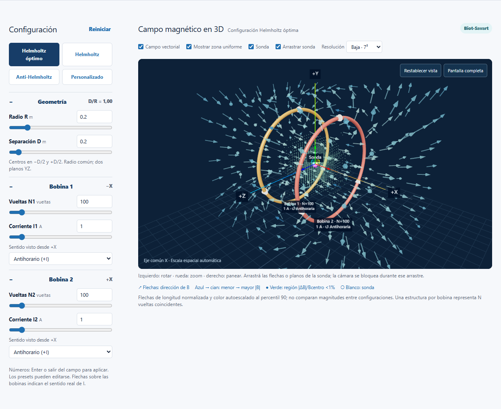
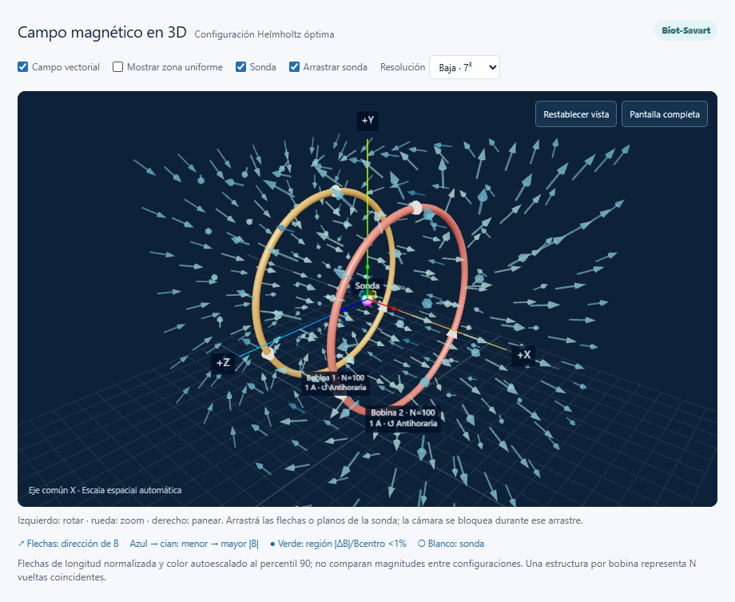
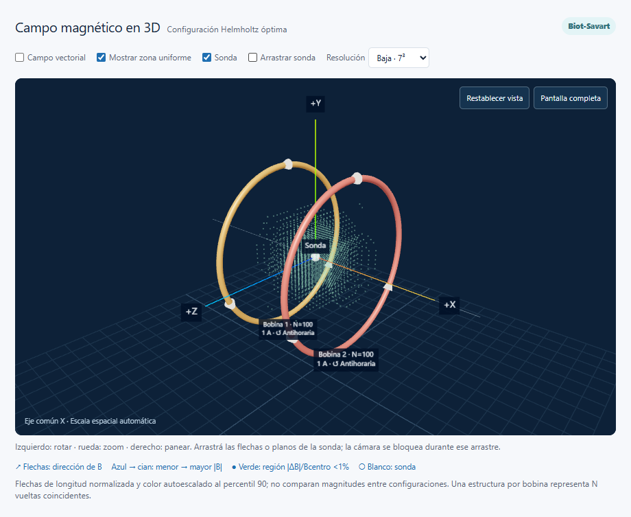
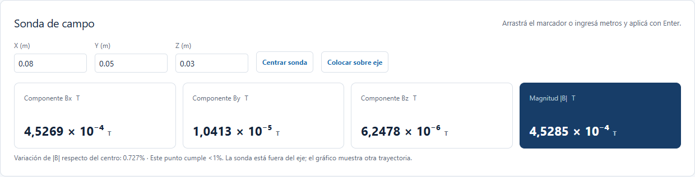
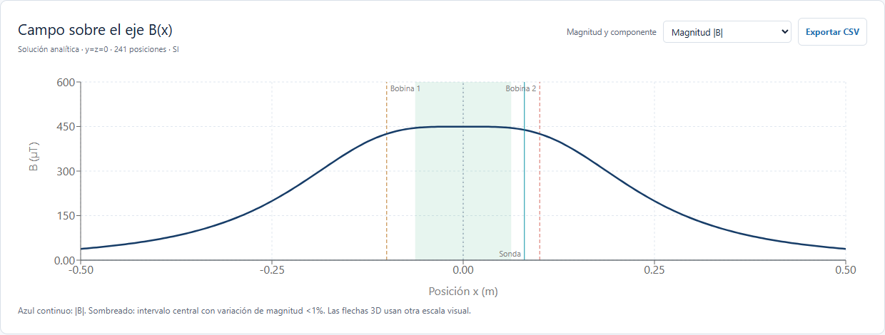
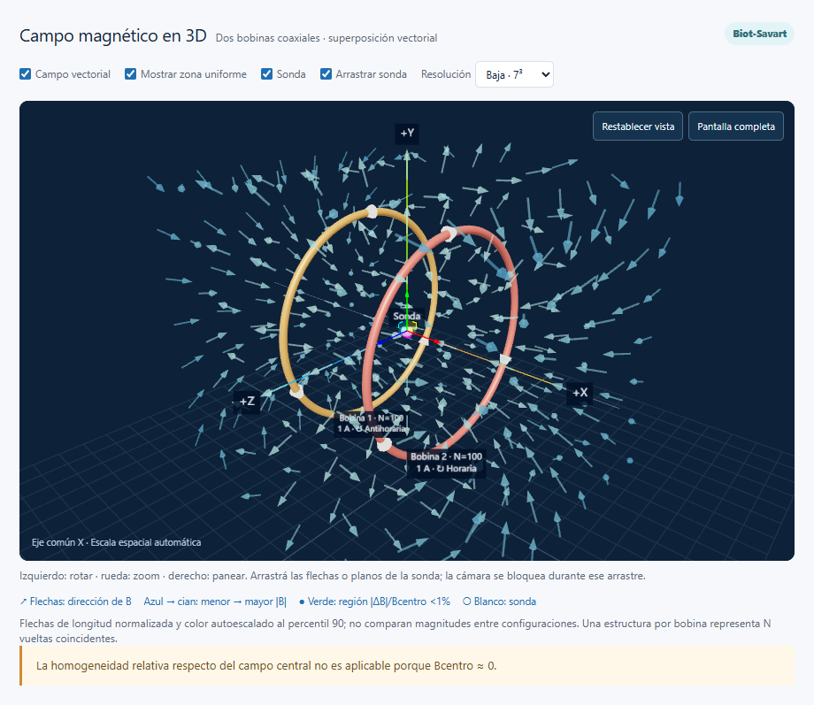
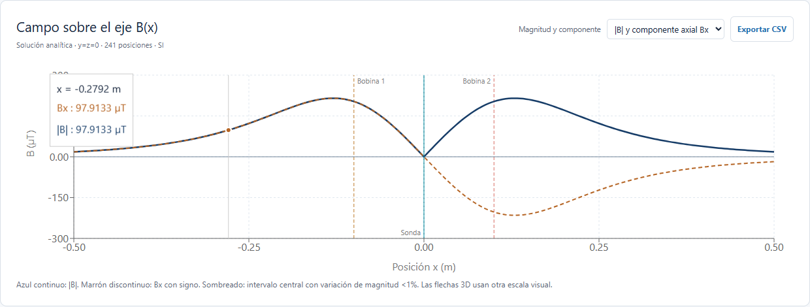

# Configuración y Mapeo de Campo de las Bobinas de Helmholtz

**UNSTA - Facultad de Ingeniería**

**Ingeniería Informática - Física II 2026**

**Trabajo Práctico 4**

Estudiante: **Baltasar Barbaglia**

Fecha de preparación: **05/10/2026**

Fecha de entrega indicada por la cátedra: **07/10/2026**

Proyecto: Laboratorio Virtual de Electromagnetismo. Cuarta experiencia: `/bobinas-helmholtz`. Este documento acompaña la aplicación y contiene la guía teórica y el manual de la entrega.

## 1. Alcance y fuentes de la materia

El TP solicita simular el campo de dos bobinas circulares paralelas en 3D, medirlo sobre el eje y fuera de él, e identificar homogeneidad. Se implementan R, D, N1, N2, magnitud y sentido de cada corriente; configuraciones paralelas y antiparalelas; matriz de vectores; sonda arrastrable; región con variación de magnitud menor al 1%; investigación de D/R; y gráfico axial. Las cuatro áreas de evaluación tienen el mismo peso: física, código/interfaz, guía/aplicaciones e innovación (25% cada una).

Orden de consulta: consigna TP4 (una página), apuntes de Semana 1B y capítulo 28 de Sears. Los apuntes incluyen otros temas, pero la experiencia se concentra en las dos bobinas. Los PDF originales permanecen en la raíz del checkout original y no se distribuyen como recursos web.

| Material | Contenido utilizado |
| --- | --- |
| TP 4 Inf 2008 Bobinas de Helmhotlz.pdf | Variables, visualización, sonda, 1%, gráfico, estructura de la guía, fecha y evaluación. Aunque el nombre contiene 2008, el contenido indica Física II 2026. |
| Contenidos de Clase Semana 1B Torque y Fuentes de B.pdf | p. 4: μ0; p. 6: Biot-Savart vectorial e integral; p. 9: espira, N vueltas, campo axial y central. |
| Cap. 28 Fuentes B.pdf | §28.2, p. impresa 961 (PDF 5), ecs. 28.6-28.7; §28.5, pp. 967-968 (PDF 11-12), ecs. 28.12-28.17; problema 28.67, p. 990 (PDF 34), par Helmholtz y derivadas centrales. |

Los apuntes escriben el radio como a; aquí se llama R. La expresión central Helmholtz se **deduce** de la fórmula axial de Sears y la superposición; no se atribuye a una ecuación impresa que no aparece en esas páginas.

## 2. Fundamentación física

### Campo y fuente

El campo magnético B es un vector: especifica magnitud y dirección en cada punto. Su unidad SI es el tesla (T). Una carga en movimiento experimenta F=q(v×B), relación estudiada en la segunda experiencia. En este TP calculamos B a partir de su fuente: una corriente estacionaria. Una bobina reúne vueltas conductoras para sumar sus contribuciones y generar un campo útil.

En la aproximación magnetostática, la corriente es constante en el tiempo y el medio se aproxima por vacío/aire. Se utiliza el valor de clase μ0=4π×10⁻⁷ T·m/A. No hay materiales ferromagnéticos ni un campo terrestre agregado automáticamente.

### Biot-Savart y mano derecha

Para un elemento de conductor dℓ dirigido en el sentido de la corriente:

\[
d\mathbf B=\frac{\mu_0 I}{4\pi}\frac{d\boldsymbol\ell\times\hat{\mathbf r}}{r^2}
=\frac{\mu_0 I}{4\pi}\frac{d\boldsymbol\ell\times\mathbf r}{|\mathbf r|^3}.
\]

r apunta desde el elemento fuente hasta el punto de observación. El producto vectorial produce una dirección perpendicular a dℓ y r. Su magnitud incluye el seno del ángulo entre ambos; su sentido se determina con la mano derecha. Integrar todos los elementos genera el campo total de la espira, como en Sears (28.7).

### Coordenadas y corriente con signo

El eje común es **X**. Los centros son x1=−D/2 y x2=+D/2; cada bobina está en un plano YZ y tiene radio común R. La posición de la sonda es (x,y,z), en metros. D siempre significa distancia entre centros, no distancia entre bordes.

La convención de corriente se define **vista desde +X hacia el origen**. Antihoraria corresponde a I positiva; horaria a I negativa. Por la mano derecha, una espira con I positiva genera Bx positivo en su eje. Los selectores muestran la convención y las puntas sobre cada bobina muestran el sentido; los colores identifican bobinas, no sustituyen la dirección.

### Derivación del campo axial

Parametrizamos una espira centrada en x0:

\[
\mathbf r_c(\varphi)=(x_0,R\cos\varphi,R\sin\varphi),\qquad
d\boldsymbol\ell=(0,-R\sin\varphi,R\cos\varphi)d\varphi.
\]

En un punto del eje P=(x,0,0), sea u=x−x0. Entonces r=(u,−R cosφ,−R sinφ), y |r|=√(R²+u²), constante para todos los elementos. El producto vectorial es

\[
d\boldsymbol\ell\times\mathbf r=(R^2,Ru\cos\varphi,Ru\sin\varphi)d\varphi.
\]

Las integrales de seno y coseno entre 0 y 2π son cero: las componentes transversales se cancelan por simetría. La componente X integra R²dφ y da 2πR². Así se obtiene la ecuación de Sears (28.15):

\[
B_x(x)=\frac{\mu_0 I R^2}{2[R^2+(x-x_0)^2]^{3/2}},\qquad B_y=B_z=0.
\]

Si N vueltas tienen el mismo radio y están suficientemente juntas para tratarlas como coincidentes, cada una aporta el mismo vector. Por superposición:

\[
B_x(x)=\frac{\mu_0 N I R^2}{2[R^2+(x-x_0)^2]^{3/2}}.
\]

Esto corresponde a Sears (28.16). En el centro de una sola bobina, x=x0, resulta Bx=μ0NI/(2R), ec. (28.17). El signo de I se conserva.

### Dos bobinas

La suma es vectorial en cualquier punto: **B=B1+B2**. No se suman magnitudes salvo que las direcciones coincidan. Sobre X solo queda una componente:

\[
B_x(x)=\frac{\mu_0R^2}{2}
\left[\frac{N_1I_1}{(R^2+(x+D/2)^2)^{3/2}}
+\frac{N_2I_2}{(R^2+(x-D/2)^2)^{3/2}}\right].
\]

Con corrientes iguales y paralelas y N1=N2 aparece una meseta central. La aplicación permite editar las bobinas independientemente; si se rompe esa simetría, D=R no basta para afirmar que la configuración es Helmholtz óptima.

### Por qué D=R es especial

Para bobinas idénticas con corriente con signo I, sea a=D/2, C=μ0NIR²/2 y f(u)=(R²+u²)⁻³ᐟ²:

\[
B_x(x)=C[f(x+a)+f(x-a)].
\]

La función es par: Bx(−x)=Bx(x). Por ello B′x(0)=0 para cualquier D, y también se anulan todas las derivadas impares centrales. Derivando:

\[
f'(u)=-3u(R^2+u^2)^{-5/2},\quad
f''(u)=\frac{3(4u^2-R^2)}{(R^2+u^2)^{7/2}}.
\]

Luego

\[
B''_x(0)=\frac{6C(4a^2-R^2)}{(R^2+a^2)^{7/2}}.
\]

Para R>0 y corriente no nula, anular la curvatura exige 4a²=R². Como a=D/2 y D≥0, **D=R**. La expansión de Taylor central comienza a variar en orden x⁴ en vez de x². Esto explica la homogeneidad local, sin afirmar que todo el espacio tenga campo constante. No es una optimización universal del volumen para cualquier métrica o bobinas desiguales.

Sustituyendo x=0 y D=R en la superposición:

\[
B_0=\left(\frac45\right)^{3/2}\frac{\mu_0NI}{R}.
\]

Con R=D=0,20 m, N=100 e I=1 A: B0=4,4958814×10⁻⁴ T, aproximadamente 449,59 µT. Como comprobación adicional del problema 28.67, R=0,08 m, N=300 e I=6 A da aproximadamente 0,0202315 T.

### Anti-Helmholtz

Para bobinas iguales con corrientes de igual magnitud y sentidos opuestos:

\[
B_x(x)=C[f(x+a)-f(x-a)].
\]

Es una función impar y Bx(0)=0. Alrededor del centro el campo cambia aproximadamente de manera lineal, con gradiente B′x(0)=−6Ca/(R²+a²)⁵ᐟ² para la primera bobina positiva. El gradiente es una variación espacial en T/m; no equivale a un campo uniforme. La gráfica conserva |B| y permite añadir Bx firmado para mostrar el cambio de sentido.

## 3. Qué significa el 1%

La consigna no fija una norma matemática ni una referencia para esa variación. Adoptamos explícitamente la **variación de magnitud respecto del centro**, coherente con el gráfico de magnitud requerido:

\[
B_{ref}=|\mathbf B(0,0,0)|,\qquad
\epsilon(p)=\frac{\big||\mathbf B(p)|-B_{ref}\big|}{B_{ref}},\qquad
\epsilon(p)<0,01.
\]

Este criterio no garantiza que la dirección también sea idéntica: por eso se conserva el mapa vectorial. La referencia se calcula analíticamente sobre el eje. Si Bref≤max(10⁻¹⁵ T, 10⁻¹⁰ por la suma de las magnitudes centrales individuales), se declara no aplicable. Así se cubren cancelación Anti-Helmholtz y corrientes apagadas sin dividir por cero.

El intervalo axial es el tramo conectado que contiene x=0. Se explora con paso R/200 hasta la primera salida del criterio en cada sentido y se refina la frontera mediante 32 pasos de bisección. La región espacial se muestrea en centros de 21³ celdas del cubo ±0,6R en cada eje. Se dibujan solo puntos aceptados, no una envolvente inventada. El volumen estimado es número de celdas aceptadas por (1,2R/21)³. Puede incluir zonas desconectadas del centro y depende de la resolución; no es el volumen exacto de una superficie continua.

La tarjeta de error máximo corresponde **a los puntos aceptados de la nube**, no a todo el cubo. La nube se distingue mediante puntos verdes; las flechas representan B. Para configuraciones asimétricas se mantiene el criterio respecto del origen, sin etiquetarlas automáticamente como óptimas.

## 4. Manual de usuario

1. Ejecutar `npm install` y `npm run dev` y abrir el enlace de Bobinas de Helmholtz desde Inicio o la navegación. Para una entrega HTML estática, `npm run build:static` genera `out/`; debe servirse con un servidor estático o el protocolo de Electron, no abrirse con doble clic en un archivo HTML.
2. Elegir **Helmholtz óptimo** (igual N/I/sentido, D=R), **Helmholtz** (iguala bobinas y sentido conservando D), **Anti-Helmholtz** (iguala N/I e invierte el segundo sentido), o **Personalizado** (conserva todos los valores para editarlos). Los cambios posteriores permanecen habilitados.
3. Radio: 0,05-1 m; separación: 0-3 m; vueltas: 1-1000 enteras; corriente: 0-10 A por bobina. Los números se aplican con Enter o al salir del campo; los sliders responden directamente. Son rangos pedagógicos, no especificaciones de un equipo real. D=0 permite estudiar bobinas coincidentes. La escena adapta su escala a max(R,D/2) y muestra D/R.
4. Rotar con botón izquierdo, zoom con rueda y panear con botón derecho. **Restablecer vista** devuelve cámara y objetivo al origen. **Pantalla completa** amplía el viewport; Escape permite salir.
5. Activar campo, región uniforme o sonda según el objetivo. Cambiar resolución 7³/9³/11³ modifica solo la matriz visual. Cada bobina se dibuja con una estructura circular y tres puntas de sentido; no se dibujan N geometrías.
6. Arrastrar un eje o plano del gizmo de la sonda. OrbitControls se deshabilita durante la traslación. Los inputs X/Y/Z permiten posicionamiento por teclado; aplicar con Enter o al salir del campo. **Centrar sonda** lleva al origen y **Colocar sobre eje** conserva X y pone Y=Z=0. El volumen de movimiento es |x|≤D/2+1,5R, |y|,|z|≤1,5R.
7. Leer Bx, By, Bz y |B| en teslas. En el centro simétrico o sobre X, las componentes transversales se cancelan; fuera del eje pueden aparecer. Cerca del filamento no se da una lectura ficticia: se muestra la advertencia de distancia mínima 0,015R.
8. Observar B(x): magnitud azul y, opcionalmente, Bx discontinuo. Líneas verticales señalan bobinas, origen y sonda axial. El sombreado corresponde al intervalo <1%. Fuera del eje, el gráfico y la sonda miden lugares diferentes. El CSV incluye `x_m`, `Bx_T`, `magnitude_T`.
9. **Reiniciar** devuelve R=D=0,20 m, N1=N2=100, I1=I2=1 A, sentidos antihorarios, sonda al centro y cámara inicial. Los toggles y la calidad se conservan.

Mientras aparece **Actualizando…**, los resultados y la escena conservan juntos la configuración anterior hasta recibir el nuevo muestreo. No mezclar la lectura anterior con el valor recién ingresado. El cálculo es enteramente local; no requiere Internet, texturas ni modelos remotos.

### Experimentos sugeridos

| Experimento | Acción y predicción |
| --- | --- |
| Helmholtz óptimo | R=D=0,20 m, N=100, I=1 A. B0≈449,59 µT; meseta central e intervalo de unos 12,55 cm. |
| D<R | D=0,10 m. Intervalo central ≈4,02 cm; la curvatura central es negativa. |
| D>R | D=0,30 m. Intervalo ≈4,60 cm; la curvatura central es positiva. |
| Anti-Helmholtz | Invertir solo el segundo sentido manteniendo N e I iguales. Bcentro≈0, Bx cambia de signo, homogeneidad relativa no aplicable. |
| Duplicar corriente | Volver al óptimo y poner ambas corrientes en 2 A. B0≈899,18 µT y misma variación relativa. La escala de color se adapta; comparar números. |
| Duplicar vueltas | Poner N1=N2=200. B también se duplica. Si se cambia solo N1, no se conserva la simetría. |

## 5. Explicación del código y del método numérico

| Archivo | Responsabilidad |
| --- | --- |
| `src/types/helmholtz.ts`, `src/data/helmholtz.ts` | Contratos, presets, límites SI, segmentos, exclusión del filamento, grillas y conversión a µT. |
| `src/lib/constants.ts` | μ0 centralizado junto a las constantes existentes. |
| `src/physics/helmholtz.ts` | Funciones puras: bobinas, Biot-Savart vectorial, distancia al círculo, superposición, eje analítico, referencia, intervalo y muestreo. |
| `src/physics/helmholtz.worker.ts` | Ejecuta el mapa y la nube en un Web Worker, fuera del hilo de interfaz. |
| `src/components/simulator/useHelmholtzMap.ts` | Una tarea en vuelo y solo el último pedido pendiente; ignora resultados obsoletos y termina el worker al desmontar. |
| `src/components/simulator/HelmholtzLab.tsx` | Estado, presets, coordinación de resultados coherentes, controles visuales y carga diferida del canvas. |
| `src/components/controls/HelmholtzControls.tsx`, `HelmholtzNumber.tsx` | Entradas y sliders con límites, unidades y sentidos explícitos; borrador local para escribir decimales y negativos antes de aplicar. |
| `src/components/simulations/HelmholtzScene.tsx` | Three.js mediante Fiber; bobinas, flechas instanciadas, nube, cámara y TransformControls. |
| `src/components/results/HelmholtzProbe.tsx` | Posición accesible, lectura física, variación y advertencia cerca del conductor. |
| `src/components/charts/HelmholtzChart.tsx` | Recharts, fórmula axial, marcadores, magnitud/signo y CSV. |
| `src/components/theory/HelmholtzTheory.tsx` | Explicación dinámica y ecuaciones visibles. |
| `src/app/bobinas-helmholtz/page.tsx` | Página servidor de la experiencia. Solo la escena WebGL usa `ssr:false`. |

La integración numérica emplea cuadratura de **punto medio sobre la curva**, no un polígono de cuerdas: φk=(k+1/2)2π/M, dℓk=(0,−R sinφk,R cosφk)2π/M. Para cada P se calcula rk=P−rck, su norma y el producto dℓk×rk. Se suman M contribuciones, se multiplica por μ0NI/(4π), se repite para la otra bobina y se suman vectores. Seno y coseno se precalculan y almacenan por resolución en una caché acotada.

Se usan **128 segmentos para mapa/nube y 256 para sonda**. El eje usa la expresión analítica: es más rápida y evita error de integración. Sobre el eje el integrando axial es constante y las componentes transversales se cancelan; por eso la cuadratura obtiene allí una coincidencia especialmente precisa, que no debe confundirse con exactitud universal fuera del eje.

Three.js dibuja geometría y materiales; React Three Fiber conecta esa escena al estado de React. Drei aporta cámara orbital y traslación. Las flechas usan dos `InstancedMesh` (cuerpo y punta) para toda la grilla; la nube usa un único buffer de puntos. La longitud de las flechas está normalizada y el color usa una escala logarítmica respecto del percentil 90. La magnitud física no se deduce del tamaño del dibujo. Las etiquetas son texturas generadas en un canvas local con fuentes del sistema.

El cálculo 3D se activa solo con parámetros físicos o resolución, nunca al mover la cámara o la sonda. Si llegan múltiples cambios durante un cálculo, el worker termina esa tarea y procesa únicamente el último pedido. La sonda calcula sus 256 segmentos por separado y el gráfico memoiza 241 puntos analíticos. `frameloop="demand"` evita render continuo en reposo; el worker, las texturas y recursos de escena se liberan al desmontar.

## 6. Capturas reales

Las siguientes imágenes se capturaron en la aplicación local; no son ilustraciones generadas. Ocultar capas permite estudiar cada parte sin saturar la escena.

### Vista Helmholtz

### Matriz vectorial

### Región de homogeneidad

### Sonda fuera del eje

### Gráfico axial

### Anti-Helmholtz

## 7. Aplicaciones tecnológicas e industriales

### 1. Calibración de magnetómetros y sensores vectoriales

Un campo conocido y homogéneo permite comparar la salida del sensor con una referencia y evaluar respuesta, escala y orientación. NPL describe la generación de campos DC, calibración de magnetómetros de tres ejes y sus incertidumbres. La uniformidad sobre el volumen del sensor reduce la dependencia de su posición. El simulador ayuda a comprender la geometría, pero no sustituye un patrón trazable ni calcula la incertidumbre metrológica. Fuente: [NPL, MAT 65](https://eprintspublications.npl.co.uk/6198/).

### 2. Compensación del campo ambiental

El sistema comercial Bartington HCS permite cancelar campos y crear un ambiente magnético conocido; dispone de tres ejes y una opción de control en lazo cerrado. Ajustar corrientes produce una contribución que se suma vectorialmente al campo externo. Un único par como el simulado controla principalmente una dirección; compensar un vector ambiental general requiere más ejes y medición de referencia. Fuente: [documentación Bartington HCS distribuida por GMW](https://gmw.com/product/helmholtz-coil-system/).

### 3. Ensayos magnéticos de equipos espaciales

NASA Goddard describe tres instalaciones de bobinas Helmholtz para mediciones, pruebas y calibración de misiones orbitales e interplanetarias, con cancelación del campo terrestre. Un ambiente controlado permite caracterizar equipos antes del vuelo. Estas instalaciones reales añaden varios ejes, dimensiones grandes e instrumentación; el par ideal de esta experiencia explica la superposición y homogeneidad que las hacen útiles. Fuente: [NASA, Spacecraft Magnetic Test Facility](https://etd.gsfc.nasa.gov/capabilities/facilities-listing/spacecraft-magnetic-test-facility/).

### 4. Caracterización de contaminación magnética de componentes

ESA utiliza su Mobile Coil Facility para caracterizar magnetización remanente e inducida de equipos, entre otros ensayos. Dos pares de bobinas Helmholtz cuadradas compensan el campo ambiental; magnetómetros y rotación del equipo permiten reconstruir contribuciones magnéticas. La forma cuadrada es una realización distinta del círculo ideal aquí calculado. Fuente: [ESA, EMC Laboratory](https://technology.esa.int/lab/electromagnetic-compatibility-laboratory).

## 8. Validación y límites

Se agregaron 19 casos físicos a los 49 existentes: linealidad en I y N, superposición con signos, comparación axial, campo central de una espira y del par, ejemplo de Sears, cancelación Anti, inversión conjunta, componentes transversales y simetría rotacional, convergencia fuera del eje, singularidad, curvatura y condición D=R, intervalo, nube <1%, referencia nula y límites de sonda. Los resultados de builds, navegador, tiempos y hashes están en [INFORME_TP4.md](INFORME_TP4.md).

Las bobinas son ideales: vueltas coincidentes, radio común y filamento sin espesor; corriente uniforme; aire aproximado por μ0; régimen magnetostático. No se calcula resistencia eléctrica, calentamiento, inductancia ni transitorios. La integración es discreta y la matriz/nube no describen todos los puntos del espacio. La exclusión cercana al conductor protege la lectura sin modelar el campo interno de un cable real. Fuera del eje, la precisión depende de la distancia al filamento y de M; los tests de convergencia se refieren a puntos concretos, no a una cota global de error.

El viewport requiere WebGL y aceleración gráfica compatible. Si no está disponible, se informa y permanecen controles y cálculo numérico. La comparación de separaciones demuestra homogeneidad central para la métrica definida, no uniformidad absoluta de todo el volumen. El modo Anti puede mostrar un residuo de redondeo numérico diminuto en la sonda central: no representa un campo físico significativo.

## 9. Bibliografía consultada

1. Cátedra Física II, UNSTA. *TP 4 Inf 2008 Bobinas de Helmhotlz.pdf*. Consigna de Física II 2026, una página.
2. Cátedra Física II, UNSTA. *Contenidos de Clase Semana 1B Torque y Fuentes de B.pdf*. Diapositivas 4, 6 y 9.
3. Sears y Zemansky / Young y Freedman. *Física universitaria*, volumen 2, 12.ª edición. Capítulo 28, PDF local *Cap. 28 Fuentes B.pdf*: §§28.2 y 28.5 y problema 28.67. Los nombres de autores/edición corresponden a la identificación del material; no se agregan datos editoriales no verificados.
4. Hall et al. (2014). *Best practice guide for the generation and measurement of DC magnetic fields in the magnetic field range of 1 nT to 1 mT*. NPL Report MAT 65. Se consultó la ficha y resumen institucional: [NPL](https://eprintspublications.npl.co.uk/6198/).
5. GMW Associates / Bartington. *Bartington Helmholtz Coil System, HCS*, descripción y aplicaciones: [página técnica](https://gmw.com/product/helmholtz-coil-system/).
6. NASA Goddard, Engineering and Technology Directorate. *Spacecraft Magnetic Test Facility*: [instalación](https://etd.gsfc.nasa.gov/capabilities/facilities-listing/spacecraft-magnetic-test-facility/).
7. ESA, Directorate of Technology, Engineering and Quality. *Electromagnetic Compatibility Laboratory*: [Mobile Coil Facility](https://technology.esa.int/lab/electromagnetic-compatibility-laboratory).
8. Poimandres. [React Three Fiber, introducción y compatibilidad React](https://r3f.docs.pmnd.rs/getting-started/introduction), [Drei TransformControls](https://drei.docs.pmnd.rs/gizmos/transform-controls); Three.js, [documentación oficial](https://threejs.org/docs/). También se revisó el código de TransformControls instalado para verificar bloqueo de OrbitControls.
9. Next.js 16.3.4, documentación incluida en `node_modules/next/dist/docs/`: `use-client`, `lazy-loading` y `static-exports`.

Consulta de fuentes externas: 05/10/2026. Las fuentes externas respaldan aplicaciones reales y decisiones de software; las ecuaciones del TP se apoyan prioritariamente en los PDF de la materia.
